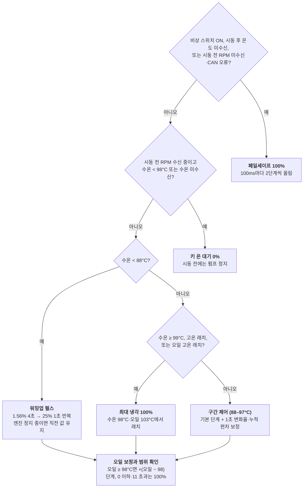

# 전동 워터펌프 제어 사양

작성일: 2026-11-10 · 원본: [Claude Docs](https://claude.ai/artifact/GxVXcDQdyL5XVFb4FvAa2F)

## 개요

컨트롤러는 냉각수 온도를 92°C로 유지하도록 전동 워터펌프(Davies-Craig EWP-80 계열)의 PWM 듀티를 100ms마다 결정한다. 입력은 CAN 버스의 냉각수·오일 온도와 RPM, 그리고 아날로그 유압 센서다. 판단할 수 없는 상황에서는 항상 100% 듀티로 돈다.

- 대상 MCU: Arduino Leonardo 호환 CAN 보드(Longan Labs, MCP2515)
- 구동: Cytron MD10C 모터 드라이버
- 표시: Grove 16x2 I2C LCD, 선택 사항으로 능동 부저
- 근거 자료: [README.md](../README.md), [EWPController.ino](../EWPController/EWPController.ino), [pump_control.cpp](../EWPController/pump_control.cpp), [test_pump_control.cpp](../test/test_pump_control.cpp), [2026-11-09-oil-pressure.md](2026-11-09-oil-pressure.md) (브랜치 `oil-pressure-median-filter`)

유압 필터와 유압 상실 경고는 `oil-pressure-median-filter` 브랜치에만 있고 main 미머지, 실차 미검증 상태다.

## 하드웨어 구성과 핀 할당

펌프는 D9의 PWM 하나로 구동하고, 방향 입력은 고정된다. 나머지 핀은 CAN, LCD, 센서, 비상 스위치에 쓴다.

| 핀 | 용도 | 방향 | 비고 |
| --- | --- | --- | --- |
| D9 | MD10C PWM | 출력 | timer1, `motor.setSpeed(0–255)` |
| D4 | MD10C DIR | 출력 | 실제로는 GND에 풀다운(정방향 고정) |
| D12 | 비상 스위치 (`OnPin`) | 입력 | LOW = 100% 강제 구동, 내부 풀업 미사용 |
| A0 | 유압 센서 | 아날로그 입력 | 0.5–4.5V = 0–145psi |
| D17 | MCP2515 CS | 출력 | CAN 500kbps |
| D14–D16 | SPI (CAN) | – | |
| D2/D3 | I2C (LCD) | – | Grove 16x2 LCD |
| D8 (권장) | 부저 | 출력 | 기본 비활성 (`BuzzerPin = -1`), HIGH = 울림 |

- 타이머: MsTimer2가 timer4를 쓰고 100ms마다 제어·표시·CAN 점검 플래그를 세운다. 실제 처리는 `loop()`에서 한다.
- 부저는 차량 12V 능동형 피에조를 NPN 트랜지스터로 구동하는 구성을 권장한다(상세는 [2026-11-09-oil-pressure.md](2026-11-09-oil-pressure.md)).

## 센서 입력 처리

온도와 RPM은 CAN에서, 유압은 A0에서 읽는다. CAN 수신이 1초 동안 멈추면 버스 오류로 보고 MCP2515를 다시 초기화한다.

### CAN 수신 (500kbps, 표준 ID)

| ID | 바이트 | 신호 | 변환 |
| --- | --- | --- | --- |
| 0x360 | 2 | 오일 온도 `OilTemp` | `buf[2] - 40` °C |
| 0x360 | 3 | 냉각수 온도 `CurTemp` | `buf[3] - 40` °C |
| 0x140 | 2–3 | 엔진 RPM `CurRPM` | `((buf[3] & 0x3F) << 8) + buf[2]` |

- 마스크 2개와 필터 6개로 0x360, 0x140만 받는다.
- 0x360을 처음 받으면 `IsReadBegan = true`. 0x140을 받으면 `HasRpmReceived = true`, RPM이 0보다 크면 `HasEngineStarted = true`.
- 엔진 정지: 최근 RPM 패킷 8개(`RpmWindow`)가 모두 0이면 `IsEngineStopped = true`. `HasEngineStarted`는 리셋 전까지 유지된다.
- 버스 감시(1초 주기): 온도 또는 RPM 패킷 수가 늘지 않으면 `IsCANBusError = true`, `IsReadBegan = false`로 두고 `CAN.begin()`과 마스크·필터를 다시 설정한다. LCD에는 해당 값 자리에 `?`와 리셋 횟수 스피너를 표시한다.

### 유압 센서 (A0, 50ms 주기)

유압은 CAN 수신과 무관하게 `loop()`에서 20Hz로 샘플링한다. 처리 순서는 다음과 같다.

1. `analogRead` 4회 평균 → 전압(5V/1023 스케일)
2. 최근 5샘플 median: 연속 2샘플까지의 스파이크 제거
3. EMA, α = 0.3 (시정수 약 0.15초)
4. 센서 상태 판정: 필터 전압이 0.1–4.8V 밖이면 센서 고장
5. psi 변환 후 0 미만은 0으로 클램프, 반올림

```math
P_{psi} = (V + V_{offset} - 0.5) \cdot \frac{145}{4}
```

- 0점 보정(`VoltOffset`): 키 온 후 시동 전(RPM 0 수신, `!HasEngineStarted`)에만, 20샘플(약 1초) 이상 쌓인 뒤 필터 전압이 0.1–0.5V이면 `VoltOffset = 0.5 − V`로 둔다. LCD row 0 col 3에 보정량을 `_`(<0.1V), `+`(<0.3V), `^`(<0.5V)로 표시한다.
- 유압 로그: 센서가 정상이고 RPM이 유효하며 0보다 클 때 `(rpm, psi)`를 150개 링 버퍼(20Hz 기준 약 7.5초)에 쌓는다. LCD는 1초마다 현재 psi와, 로그 최대 RPM ±50 안의 최대 psi를 `psi@RPM/100` 형식으로 보여준다.

## 펌프 제어 로직

`SetPumpDuty()`는 100ms마다 입력을 모아 `PumpComputeIndex()`([pump_control.cpp](../EWPController/pump_control.cpp))로 12단계 듀티 중 하나(`IndexDuty`)를 고르고, `SetMotorSpeed()`는 값이 바뀔 때만 MD10C에 출력한다. 상태를 판단할 수 없거나 계산 결과가 범위를 벗어나면 항상 100%로 간다.



위의 조건에 먼저 해당하면 아래는 보지 않는다. 워밍업, 최대 냉각, 구간 제어 결과는 모두 마지막 오일 보정을 거친다.

### 듀티 단계

| 단계 | PWM (0–255) | 듀티 (%) |
| --- | --- | --- |
| 0 | 0 | 0 |
| 1 | 4 | 1.56 |
| 2 | 8 | 3.13 |
| 3 | 16 | 6.25 |
| 4 | 32 | 12.5 |
| 5 | 64 | 25 |
| 6 | 96 | 37.5 |
| 7 | 128 | 50 |
| 8 | 160 | 62.5 |
| 9 | 192 | 75 |
| 10 | 224 | 87.5 |
| 11 | 255 | 100 |

### 모드별 동작

- **페일세이프**: 비상 스위치가 LOW이거나, 시동 후 온도를 못 받거나(CAN 오류 포함), 시동 전 RPM을 한 번도 못 받았거나 CAN 오류(`IsCANBusError`)이면 100ms마다 2단계씩 올려 11에 도달한다. 키 온 대기(0)에서 넘어오면 2, 4, …, 10, 11로 0.6초 동안 올라간다. 전원 투입 직후에도 이 상태로 시작하며, `setup()` 첫 줄에서 100%를 출력해 초기화 중에도 펌프가 돈다.
- **키 온 대기**: 시동 전이고 RPM을 받고 있으며 CAN 오류가 없고, 수온을 아직 못 받았거나 98°C 미만이면 0%. 수온이 98°C 이상이면 시동 전이라도 정상 제어로 냉각한다.
- **워밍업 (수온 < 88°C)**: 엔진이 돌고 있으면 5초 주기로 4초는 1단계(1.56%), 1초는 5단계(25%)로 구동해 냉각수를 섞는다. 엔진 정지 중에는 직전 단계를 유지한다(오일 보정은 유지한 단계에 한 번만 더한다).
- **최대 냉각**: 수온 ≥ 99°C, 고온 래치(98°C에서 설정, 95°C 미만이고 상승 중이 아니면 해제), 오일 고온 래치(103°C 설정, 100°C 이하 해제) 중 하나면 100%.
- **구간 제어 (88–97°C)**: 기본 단계에 보정값을 더한다(아래).
- **오일 보정과 범위 확인**: 정상 제어의 모든 결과에 오일 온도 ≥ 98°C이면 (오일 − 98)단계를 더한다. 결과가 0 이하이거나 11을 넘으면 11(100%)로 둔다.

### 구간 제어 계산

단계 = 기본 단계 + 보정값(최소 −3)이다. 여기서 T는 수온, f(x)는 `log10val` 표 {0, 3, 4, 5, 6, 7, 8, 8, …}이며 x는 0–15로 자른다.

- 기본 단계 = 4 + f(T − 92): T ≤ 92이면 4(12.5%), 93이면 7, 94이면 8, 95이면 9, 96이면 10, 97이면 11.
- diff: 최근 10틱(1초)의 수온 변화 합. 단조 증가나 단조 감소일 때만 값을 갖고, 오르내리면 0.
- accu: 최근 10틱의 (T − 92) 합.
- 이력은 모드와 관계없이 온도를 받는 동안 매 틱 쌓는다(키 온 대기·페일세이프 포함). 온도가 끊겼다가 다시 들어오면 첫 샘플로 10칸을 채워 "일정했던 것"으로 시작한다.

| 수온 | 하강 (diff < 0) | 정체 (diff = 0) | 상승 (diff > 0) |
| --- | --- | --- | --- |
| T < 92 | −3 | accu ≥ −10: +1 / −20 ≤ accu < −10: 0 / 그 외: −1 | accu > −20이면 f(T − 90), 아니면 0 |
| T = 92 | 0 | accu ≥ 0: +2, 아니면 0 | accu > −10이면 10 + accu, 아니면 4 |
| T > 92 | +(T − 92) | f(T − 92) | f(T − 90) |

수온이 일정할 때(diff = 0, accu = 10 × (T − 92))의 결과는 다음과 같다. 오일 보정은 제외했다.

| 수온 (°C) | 88 | 89 | 90 | 91 | 92 | 93 | 94 이상 |
| --- | --- | --- | --- | --- | --- | --- | --- |
| 단계 | 3 | 3 | 4 | 5 | 6 | 10 | 11 |
| 듀티 (%) | 6.25 | 6.25 | 12.5 | 25 | 37.5 | 87.5 | 100 |

엔진 정지 후에도 `HasEngineStarted`가 유지되므로 키 온 대기로 돌아가지 않는다. 수온이 88°C 이상이면 구간 제어가 계속돼 엔진 정지 후 냉각(애프터런) 역할을 한다.

## 경고와 고장 처리

펌프 쪽 고장 대응은 모두 100% 구동이고, 유압 쪽은 경고만 하며 펌프 듀티에는 영향을 주지 않는다.

### 펌프 페일세이프

| 상황 | 감지 | 동작 |
| --- | --- | --- |
| 전원 투입 직후, CAN 미수신 | `!HasEngineStarted && !HasRpmReceived` | 100% (`setup()` 첫 줄부터) |
| 시동 전 CAN 끊김 | `!HasEngineStarted && IsCANBusError` | 100%, CAN 재초기화 반복 |
| 시동 후 온도 끊김 | 1초간 0x360 또는 0x140 미수신 → `IsReadBegan = false` | 100%, CAN 재초기화 반복 |
| 수동 강제 | D12 = LOW | 100% |
| 계산 결과 범위 밖 | 단계 ≤ 0 또는 > 11 (키 온 대기 제외) | 100% |
| CAN 초기화 실패 (`setup`) | `CAN.begin()` 실패 | 100%, 제어 루프는 그대로 돌고 1초마다 재초기화 |

시동 전 CAN 끊김은 예전에는 키 온 대기(0%)로 빠졌다. 그 상태로 시동을 걸면 RPM이 오지 않아 `HasEngineStarted`가 바뀌지 않으므로 엔진이 도는데 펌프가 0%였다. 이때 유압 경고도 `HasEngineStarted`로 동작 여부를 가정하므로 꺼진 채로 남는다(펌프는 100%로 보호됨).

### 유압 경고 (`CheckOilPressure()`, 50ms 주기)

유압이 RPM별 하한 미만으로 0.3초 내려가면 DIP, 2초면 LOSS다. 하한 + 3psi 이상이 1초 유지되면 NORMAL로 돌아간다.

| RPM | 경고 하한 (psi) | 해제 기준 (psi) |
| --- | --- | --- |
| 500–1,499 | 6 | 9 |
| 1,500–2,999 | 15 | 18 |
| 3,000–4,499 | 25 | 28 |
| 4,500 이상 | 35 | 38 |
| RPM 모름 (2초 이상 미수신) | 5 | 8 |

- 판정 제외: RPM 500 미만, 엔진 동작 후 3초 이내. RPM을 모르면 `HasEngineStarted`로 동작 여부를 가정한다.
- SENSOR_FAULT: 필터 전압이 0.1V 미만 또는 4.8V 초과. 다른 상태보다 우선한다.
- DIP에 들어갈 때마다 `OPDipCount`를 올려 이번 전원 투입 이후 이력을 남긴다.
- 하한값은 보수적 출발값이며, 열간 실측 정상 유압의 50–60%로 조정할 예정이다.

| 상태 | LCD | 부저 |
| --- | --- | --- |
| DIP | row 0 col 4 역상 `!` | 진입 시 200ms 1회 |
| LOSS | row 1에 `OIL LOW!` 0.5초마다 일반/역상 깜박임, row 0 col 4 역상 `!` | 2Hz 연속 |
| SENSOR_FAULT | row 1에 `OP SENS?`, row 0 현재 유압 `---` | 진입 시 100ms 1회 |
| NORMAL (DIP 이력 있음) | row 0 col 4 일반 `!` | 없음 |

경고 표시는 CAN 오류 상태와 관계없이 100ms마다 갱신된다.

### LCD 배치 (16x2)

```
          0123456789012345
row 0:    ppp+!Oooo#Wwww°C
row 1:    mmmpsi@rr Pdddd%
```

| 표시 | 내용 |
| --- | --- |
| ppp / + / ! | 현재 유압(psi) / 0점 보정 표시 / DIP 표시 |
| ooo, www | 오일 온도, 냉각수 온도(°C). CAN 끊김 시 `?` |
| # | CAN 재초기화 스피너(`- / - \`) |
| mmm@rr | 최근 로그의 최대 RPM 부근 최대 유압, RPM/100 |
| P | 1초 하트비트(`P`/`p` 교대) |
| dddd% | 현재 펌프 듀티 |

## 설정 파라미터

펌프 제어 값은 `pump_control.h`, 나머지는 `EWPController.ino` 상단의 `const`이며, 바꾸려면 다시 빌드해야 한다. 제어 로직을 바꾸면 PC에서 `test/test_pump_control.cpp`를 돌린다(빌드 명령은 파일 첫 줄).

| 상수 | 값 | 단위 | 의미 |
| --- | --- | --- | --- |
| `MonitorInterval` | 100 | ms | 제어·표시 주기 |
| `TargetTemp` | 92 | °C | 목표 수온 |
| `LowTemp` | 88 | °C | 이 미만은 워밍업 펄스 |
| `MidTemp` | 95 | °C | 고온 래치 해제 온도 |
| `HighTemp` | 98 | °C | 고온 래치 설정, 키 온 대기 상한 |
| `MaxTemp` | 99 | °C | 이 이상 100% |
| `OilHotSetTemp` / `OilHotClearTemp` | 103 / 100 | °C | 오일 고온 래치 설정 / 해제 |
| `OilBoostTemp` | 98 | °C | 오일 보정 시작, 1°C당 +1단계 |
| `WarmUpTicks` / `WarmUpPeriodTicks` | 40 / 50 | 틱 | 워밍업 저듀티 구간 / 펄스 주기 |
| `WarmUpLowIndex` / `WarmUpPulseIndex` | 1 / 5 | 단계 | 워밍업 저듀티 / 펄스 |
| `FailSafeStep` | 2 | 단계 | 페일세이프 틱당 증가량 |
| `RpmWindow` | 8 | 패킷 | 엔진 정지 판정에 쓰는 연속 RPM 0 패킷 수 |
| `Duties[]` | 0–255, 12단계 | PWM | 듀티 단계표 |
| `OPSampleMs` | 50 | ms | 유압 샘플 주기 |
| `OPOversample` / `OPMedianSize` / `OPEmaAlpha` | 4 / 5 / 0.3 | – | 유압 필터 |
| `OPCalibMinSamples` | 20 | 샘플 | 0점 보정 전 최소 샘플 수 |
| `OPMonitorMinRpm` | 500 | rpm | 유압 판정 최소 RPM |
| `OPStartDelayMs` | 3000 | ms | 시동 후 판정 제외 시간 |
| `OPDipMs` / `OPLossMs` / `OPRecoverMs` | 300 / 2000 / 1000 | ms | DIP / LOSS / 복귀 지속 시간 |
| `OPHysteresisPsi` | 3 | psi | 해제 히스테리시스 |
| `OPNoRpmMinPsi` | 5 | psi | RPM을 모를 때 하한 |
| `OPSensorMinVolt` / `OPSensorMaxVolt` | 0.1 / 4.8 | V | 센서 정상 범위 |
| `RpmStaleMs` | 2000 | ms | RPM 유효 시간 |
| `OPLogSize` | 150 | 개 | psi@RPM 로그 길이 |
| `BuzzerPin` | −1 | 핀 | 부저 비활성, D8 권장 |

### 주석 정정 (2026-11-10)

코드와 달랐던 주석을 코드 기준으로 고쳤다. 동작은 바뀌지 않았다.

- 워밍업 펄스: "10초당 2초" → 5초 주기에 1초(100ms 틱 기준), 1단계 "1.25%" → 1.56%.
- `Temp1sec`, `Diff1sec`, `Accu1sec`: 이름은 그대로 두고, 100ms마다 한 칸씩 채워 1초 창을 이룬다는 주석을 추가했다.
- `OPLogSize`: "5Hz 30sec" → 20Hz × 150 = 약 7.5초. `DispOilPressure()`의 "past 10 seconds"도 약 7.5초로 고쳤다.
